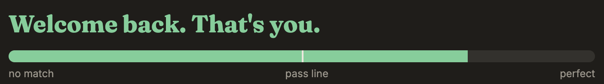
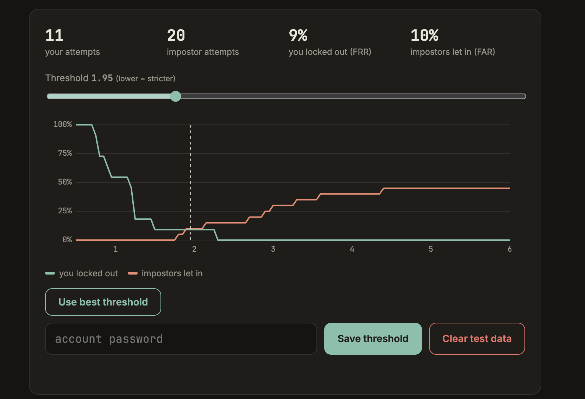
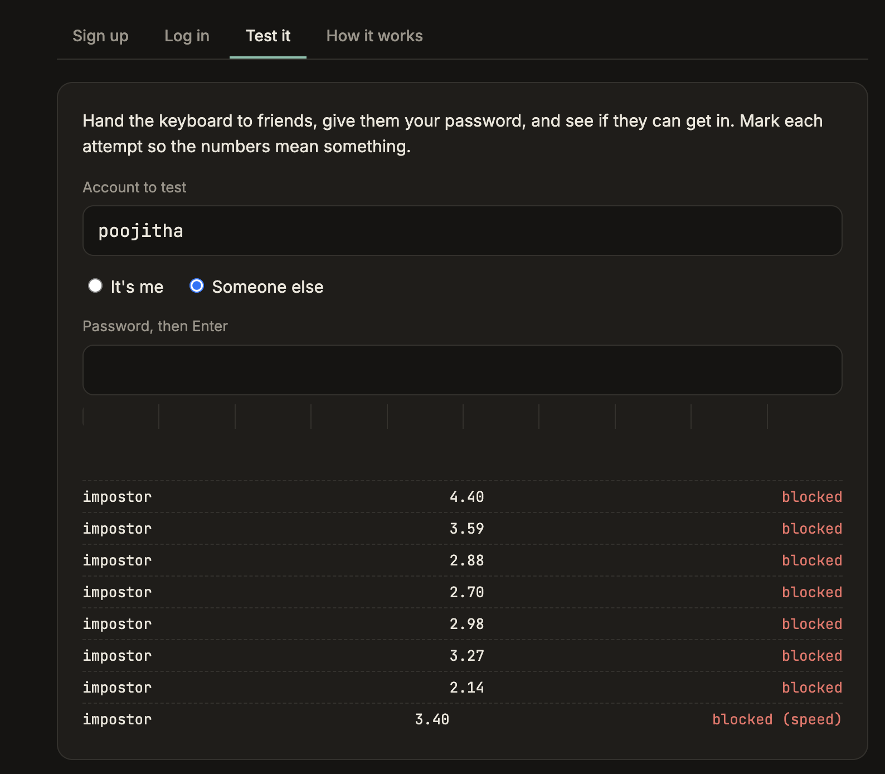
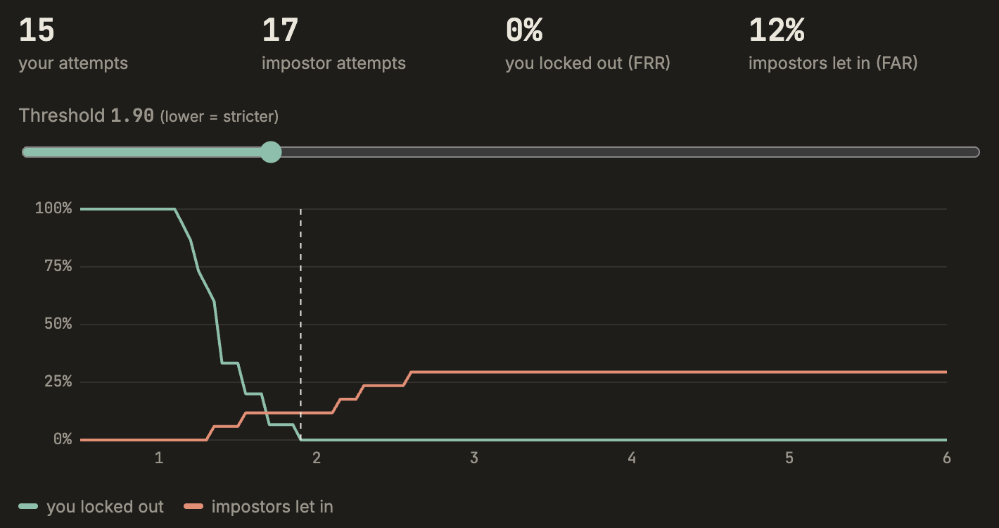
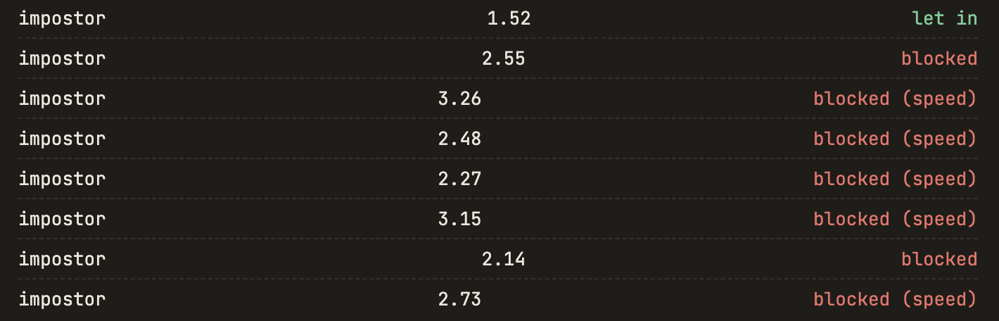
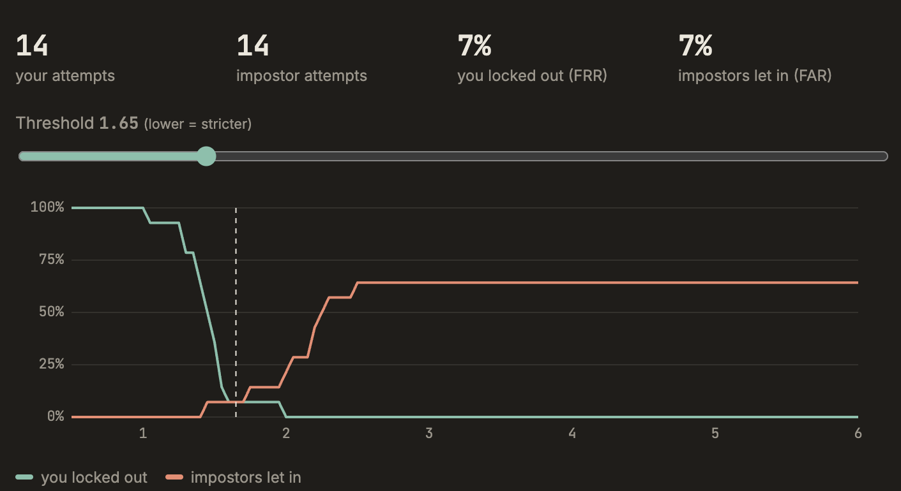
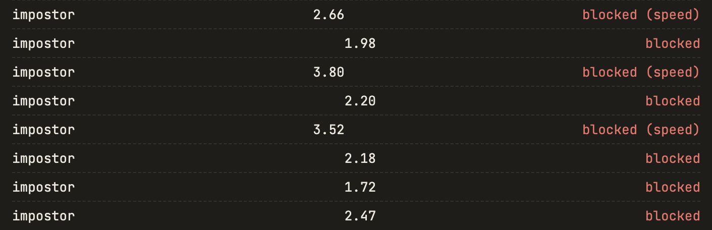

# Cadence

[](https://github.com/p-yarlagadda07/Cadence/actions/workflows/tests.yml)

A login system that checks how you type your password, not just what you type.

Everyone has their own typing rhythm. How long you hold each key, how quickly
you move between certain letters, where you pause, how you use the Shift key.
Cadence learns that rhythm when you sign up, and on every login it checks both
the password and the rhythm. If someone else types your password correctly but
with a different rhythm, they don't get in.

This is called keystroke dynamics, a type of behavioural biometrics.

On the CMU keystroke benchmark (51 typists, 20,400 typed passwords) Cadence's
matching beats the published scaled Manhattan method in like-for-like tests:
**9.1% vs 9.6%** with the paper's training setup, and **5.7% vs 8.4%** when
both are trained on 8 typings of a familiar password, the way Cadence signs
people up. With real people on the live site it's about 7%.

**Live demo:** https://pyarlagadda07.pythonanywhere.com

Built by Poojitha Yarlagadda ([@p-yarlagadda07](https://github.com/p-yarlagadda07)).



## Why I built it

I've been getting into cybersecurity, and most of what we do in college is
development, so I wanted a project that was actually about security. I also
wanted to understand behavioural biometrics properly, not just read about them.
The question that got me started was simple: if someone steals your password,
is there anything left that still proves it's you? It turns out the way you
type it is surprisingly hard to copy.

## Running it

You need Python 3.10 or newer.

```
pip install -r requirements.txt
python -m flask --app app run --port 5001
```

Then open http://localhost:5001. On a Mac, port 5000 is taken by AirPlay, which
is why this uses 5001. Use a laptop or desktop keyboard; phones don't report key
timings properly.

To stop new people signing up once your own accounts exist (the Sign up tab
disappears and the server refuses new accounts):

```
python -m flask --app app signups off
```

`signups on` opens it again. Existing accounts keep working either way.

To run the tests:

```
pip install pytest
pytest
```

They cover the matching logic and every API route, including lockout, recovery
codes and upgrading an old database. GitHub Actions runs them on every push.

## How it works

**Capturing the rhythm.** The browser records the exact time every key goes
down and comes back up (`static/app.js`). Corrections aren't allowed, so
backspace, arrow keys or pasting throw the sample away, because a password
you fixed halfway through doesn't have your normal rhythm.

**Features.** For a password of n characters we get 2n - 1 numbers
(`rhythm.py`):

- hold time for each key
- time from pressing one key to pressing the next

The first version also used the time from releasing one key to pressing the
next. I dropped it because it's just the second one minus the hold time, so it
was counting the same information twice and giving some keys too much weight.

**Shift key.** For every capital or symbol, three more things get recorded: how
long before the letter you pressed Shift, how long after the letter you let go
of it, and whether you used left or right Shift. Most people are very
consistent about this and it varies a lot between people, so passwords with
capitals and symbols are much harder to fake. Using the other Shift key, or
Caps Lock instead of Shift, adds a fixed penalty to the score.

**Signing up.** You type the password 8 times. For each feature we store the
average and how much it usually varies (mean absolute deviation). If one sample
is way off from the rest, it gets dropped. The starting threshold is worked
out from how much your own samples disagree with each other.

**Logging in.** The new attempt is compared using scaled Manhattan distance:

```
distance = average over all features of |attempt - your average| / your usual variation
```

If the password is right and the distance is under your threshold, you're in.
Dividing by your usual variation matters, because a gap you're always
consistent on should count more than one that's all over the place.

The 2 timings furthest from your usual are left out of the average. People
hesitate on a key now and then, and before this one slow key could sink an
attempt that was right everywhere else. Shift key checks are always counted.

I went with this method because
[Killourhy and Maxion (2009)](https://www.cs.cmu.edu/~keystroke/) compared 14
keystroke detectors on the same dataset and scaled Manhattan came out on top,
while being simple enough to explain in a few lines.

**Speed check.** Averaging every timing together has a weak spot. If someone
types with a similar pattern but noticeably faster, each gap only moves a
little, so the overall score can still pass. To catch that, the profile also
stores how long you usually take to type the whole password and how much that
varies. An attempt far outside your normal time is rejected no matter what the
rhythm score says.

The usual time comes from your saved samples, which are mostly your recent
successful logins, not just sign up. I found that out the hard way: people type
slowly and carefully while signing up, then type normally afterwards, so the
app kept thinking I was "too fast". Your pace also changes from day to day, so
the check allows anything within about a third of your usual time either way.
New accounts also get some extra speed leniency until they have 12 samples.
Blocked logins never update the profile, otherwise someone could slowly train
your account to accept them.

**Close calls.** One typing is a small sample, and a lot of mistakes happen
right around the threshold. So unless an attempt is clearly you (under 80% of
your threshold), the app asks you to type it once more. If the first one was a
close call (up to 130% of the threshold), it decides on the average of the two.
If the first one was far off, the second can't save it. On the CMU data this
cut wrong rejections from 5.7% to 4.1% and impostors getting in from 4.6% to
3.7%, the same on both halves of the typists, and you only get asked about one
time in five.

The catch is that "type it once more" could tell an impostor they were close.
So everyone who isn't clearly you gets asked, whether they were close, way off,
or typed the wrong password. The second request means nothing on its own. The
first typing's score is kept on the server, not in the browser, and the pair
counts as one attempt towards the lockout.

It can be switched off, which goes back to deciding on a single typing:

```
python -m flask --app app retype off
```

**Starting threshold.** At sign up the threshold comes from how much your 8
typings vary, but it's capped at 2.2. Before the cap it once came out at 2.60,
which let 29% of impostors in, and every time I tuned it with real attempts it
ended up between 1.6 and 1.95.

**Lockout.** After 5 failed logins in a row (wrong password or wrong rhythm)
the account locks for 15 minutes. Without this, someone who knows your
password could keep trying until one attempt happens to land close enough.
The lock only applies to the network the failures came from. Otherwise anyone
who knew your username could keep you locked out just by typing rubbish, and
you'd still get in from home. On top of that, one network can only rack up 40
failed logins an hour across all accounts, so nobody can work through a list of
usernames. Usernames that don't exist fail in exactly the same way, with the
same message and the same delay, so the login can't be used to check who has
an account. When you sign up you get a recovery code, shown once, which unlocks the account
straight away. Using it gives you a new one, so each code only works once. It's
stored hashed, like the password.

**What a failed login shows.** Just "Login failed" and how many tries are
left. Wrong password, wrong rhythm and wrong speed all look the same. The first
version showed the score, which check failed and even charts of your usual
rhythm, which is a gift to an attacker: they could see exactly how you type and
keep adjusting until they got in. Security people call this an oracle. Typing
timings are also checked before the password, so a broken request can't be used
to find out whether a guessed password was right.

**Security alerts.** If someone types your correct password but their typing
doesn't match, the attempt is saved. Next time you log in you see when it
happened and why it was blocked, for example:

> Compared with you, they:
> - used the right Shift for 'H', you use the left
> - went between 'd' and '@' 1.4x faster than you
> - held '6' 1.9x as long as you do

So the explanation goes to the owner, never to the person trying to get in. A
blocked attempt with the right password also means someone knows it, which you
would otherwise never find out. Alerts store key positions, not characters, so
the database never holds pieces of your password; the letters are filled in
from the password you just typed.

**Adapting.** Every successful login gets added to your profile (the last 15
are kept), so it keeps up if your typing slowly changes.

## Testing it properly

The Test tab is where you find out if it actually works. It only opens after
you've logged in, because it shows how close each attempt was, which would help
someone practise copying you. Once you're logged in, type your password a few
times marked as "It's me", then hand the keyboard to friends and let them try
marked as "Someone else". It shows two numbers:

- **FRR (false reject rate):** how often you get locked out of your own account
- **FAR (false accept rate):** how often someone else gets in

You can also let people test from their own devices. On the Test page, pick
how long to open your account for (30 minutes up to a week) and add an
optional note, for example the password if it's a throwaway test account.
While it's open, anyone who visits sees "Can you get into this account?" and
can try, but they only ever see "Let in" or "Blocked". They never see the
username, not even in the page source. Each person gets 15 tries per
round, so it can't be used to practise until something works, and there's a
looser cap per network as a backstop. Their attempts land in your stats as
someone else. Public tries never lock your account or create security alerts,
and testing closes by itself when the time runs out.

Making it stricter lowers FAR but raises FRR, and the other way round. The
chart shows both across every threshold, and "Use best threshold" picks the
middle of the range with the fewest mistakes.

## Results

### CMU benchmark

Testing with friends only goes so far, so I also ran Cadence's matching code on
the [CMU Keystroke Dynamics Benchmark](https://www.cs.cmu.edu/~keystroke/), the
dataset the 2009 paper used: 51 people, each typing `.tie5Roanl` 400 times. I
followed the paper's own evaluation script, and first reproduced its result to
make sure my evaluation was right.

| Detector | Trained on | EER |
| --- | --- | --- |
| Paper's scaled Manhattan (my reproduction) | first 200 typings | 9.6% |
| Cadence rhythm score | first 200 typings | 9.1% |
| Paper's scaled Manhattan | 8 familiar typings | 8.4% |
| Cadence rhythm + speed check | 8 familiar typings | **5.7%** |

My reproduction matches the paper's published 9.62%. Cadence does better in
both settings, because it drops the release-to-press timings, which only repeat
what the other measurements already say, and because it forgives the 2 keys
that are furthest off. That second change came from the benchmark itself: most
of the real attempts it was rejecting were off on just one or two keys. It took
the result from 7.9% to 5.7%. "8 familiar typings" is the
closest match to signing up for Cadence: 8 typings of a password the person
already knows.

It also showed what Cadence is bad at. Trained on someone's first 15 attempts
at a password they had never typed before, the error rate jumps to 31%,
because their rhythm keeps changing while they learn it. And the speed check
doesn't help on this dataset, since none of its impostors are trying to copy
anyone. Full results and how to run it are in [benchmark/](benchmark/).

### Testing with real people

I tested it three times: once on my laptop, then twice on the live site as I
fixed problems the earlier rounds showed up. The latest round got both error
rates down to 7%, close to what the benchmark predicts.

#### Round 1: on my laptop

**Setup.** One account, mine, with a 9 character password: 1 capital letter,
1 special character and 2 numbers. I type capitals and symbols with the right
Shift key, on my laptop keyboard. After signing up I logged in normally a few
times so the profile could settle, then did 11 attempts as myself.

Four friends then tried my password, 4 to 5 attempts each, 20 attempts in
total. Two of them practised it a few times before their recorded attempts and
two went in cold. One friend also watched me type it first and tried to copy
my rhythm.

At a threshold of 1.95:

| | Attempts | Result |
|---|---|---|
| Me (FRR) | 11 | 1 blocked, 9% |
| Impostors (FAR) | 20 | 2 let in, 10% |

The two error rates cross at about 10%, which is the equal error rate.



Impostor attempts on the Test page. Most score well above my usual range, and
one was caught by the speed check:



#### Round 2: on the live site

After deploying, I made a fresh account on the live site with the same kind of
password. At first a lot of my own logins got blocked for speed, because I had
typed slowly while signing up and the app took that as my normal pace. After
changing the speed check to use my recent logins instead, I did 15 attempts as
myself, and four other people made 17 attempts with my password.

The threshold the app picked at sign up was 2.60, which let 29% of impostor
attempts through. Using the Test page to tune it down to 1.90:

| | Attempts | Result |
|---|---|---|
| Me (FRR) | 15 | 0 blocked, 0% |
| Impostors (FAR) | 17 | 2 let in, 12% |



Most of the impostor attempts that got blocked were caught by the speed check,
not the rhythm score:



#### Round 3: on the live site, a day later

The next day my own logins started getting blocked for speed again, even with
good rhythm scores. I checked the profile on the server and found the problem:
it only allowed about 21% difference from my usual time, and my pace that day
was different from the night before. After widening the allowed range and
judging speed across all my saved logins, I cleared the test data and started
again. I did 14 attempts as myself, and two other people made 14 attempts with
my password.

Using "Use best threshold", which picked 1.65:

| | Attempts | Result |
|---|---|---|
| Me (FRR) | 14 | 1 blocked, 7% |
| Impostors (FAR) | 14 | 1 let in, 7% |

The two lines cross at about 7%, the lowest equal error rate so far.



Most impostor attempts were well above my usual range, and the speed check
caught the ones that were furthest off:



**How it got there.**

- The first version, without the Shift key or the speed check, had an equal
  error rate of about 29%. Some impostors were typing the same pattern as me,
  just faster, and the averaged score couldn't tell the difference.
- Adding the speed check stopped impostors who type at a very different pace.
- Recording Shift timing helped the most. In one test, an attempt with the same
  letter rhythm as me but a different Shift habit scored 2.68, while my own
  attempts usually land between 0.8 and 1.5.
- The first speed check was too strict and blocked me whenever I typed a bit
  faster than usual, so I loosened it after testing.
- On the live site, the speed check judged me against my careful sign up
  typing. Basing it on my recent logins fixed that, but the next day I got
  blocked again because I was typing at a different pace than the night before.
  Widening the allowed range fixed it without letting more strangers in.
- The automatic threshold from sign up is a starting point, not the final
  answer. Tuning it with real attempts from other people mattered a lot.

**What surprised me.**

- Watching someone type really does help copy them. One of the two impostor
  attempts that got in was from the friend who watched me first. Shoulder
  surfing isn't just about seeing the password.
- Short or common passwords are almost useless for this. When I tested with a
  plain English word, everyone typed it in the same quick burst and the system
  couldn't separate people at all. Capitals and symbols made a huge difference.
- My own typing varies more than I expected. Some days I'm just faster, which
  is why the speed check had to be loosened.

These are small tests with a handful of people, so on their own the exact
numbers wouldn't mean much. The CMU benchmark above is the bigger test, and it
lands in the same place.

## Project structure

```
app.py               Flask server and API
rhythm.py            feature extraction, matching, threshold
templates/index.html the page
static/app.js        key recording, charts, UI
static/style.css     styles
tests/               pytest tests for rhythm.py and the API
benchmark/           CMU benchmark script and results
```

Data goes into a local SQLite file, `cadence.db`, which gets created on first
run. Passwords and recovery codes are stored hashed (werkzeug), never in plain
text.

A few smaller things: one network can create at most 20 accounts an hour,
requests over 64 KB are refused, and every page tells the browser not to load
it inside someone else's frame, so another site can't overlay it and record
what you type.

## Limitations

- This is a demo. Logging in starts a session, but there's no app behind the
  login, so the session only unlocks your charts and the Test page.
- The Test page doesn't count towards the lockout. It's owner only, but a
  friend you hand the keyboard to can still see their scores there. That's the
  point of it, and it would be removed in a real deployment.
- Your rhythm can change with a different keyboard, an injury, or being half
  asleep, so this works best as an extra check alongside the password, not a
  replacement for it.
- Sign up still says when a username is taken, like almost every site. The
  sign-up limit keeps anyone from checking names in bulk.
- Limits go by IP address, so a lot of people behind the same college Wi-Fi
  share them, and someone with many IP addresses could spread out their tries.
- Someone who records your typing (screen recording, a keylogger) could in
  theory replay your timings.

## Ideas for later

- Try other detectors (nearest neighbour, Mahalanobis distance, one-class SVM)
  and compare FAR/FRR
- Learn typing rhythm on free text, not just a fixed password
